<div align="center">



**Version 2.0 · under active development — bugs may occur**

[](#install)
[](Trop)
[](https://mpv.io)
[](LICENSE.txt)
[](https://github.com/dmtr5140/Cadence/releases)

A YouTube Music client for iPhone. Ad-free playback, Apple-grade lyrics with syllable
timing and karaoke, Canvas behind the player, and a search that reaches SoundCloud and
Yandex Music as well.

&nbsp;
&nbsp;


<sub>The app's screens, with music content replaced by placeholders.</sub>

</div>

## Highlights

| | |
| --- | --- |
| 🎤 **Lyrics like Apple Music** | Ten sources, Apple TTML with syllable timing, letter-by-letter karaoke, translations under each line, a per-track offset. |
| 📺 **Canvas** | The track's looping video behind the player: Spotify's own Canvas, Apple's motion artwork, a clip you pick yourself, or your own video from Photos. |
| 🌊 **Your Wave** | A station built from your likes: what you play most comes first, then familiar artists, then discoveries. Two songs by one artist never sit back to back. |
| 🔁 **Source fallback** | When YouTube refuses a track — region, age, deleted — the same song is looked up on the services that stream it themselves. |
| 🎧 **Five services** | YouTube Music, SoundCloud, Yandex Music, Spotify and VK in one search, as a mix or one at a time. |
| 🔐 **Sign-in without a browser** | YouTube logs in inside the app; Yandex, VK, Spotify and SoundCloud keep their own sessions with no API keys. |
| 🧊 **Native iOS 26** | Liquid Glass controls, system menus, zoom transitions, and a player redrawn after Apple Music. |

## Where the music comes from

| Service | Search and catalogue | Its own audio |
| --- | --- | --- |
| **YouTube Music** | yes, the app's home | yes |
| **SoundCloud** | yes, no keys needed | yes, public tracks; Go+ is not unlocked |
| **Yandex Music** | yes, with an account token | yes, with Yandex Plus; without it the catalogue and previews only |
| **Spotify** | after signing in to the web player | no — matched onto YouTube, and the badge says so |
| **VK** | after signing in | no — `audio.*` is closed to third-party apps |
| **Apple Music** | planned, experimental | needs MusicKit, which sideloaded builds cannot use |

Nothing is substituted silently: a track that plays from another service says which one.

## Lyrics

- Ten sources, in this order by default: Unison, Better Lyrics, lrc.red (the Binimum backend), LyricsPlus and Paxsenix, then Musixmatch, Netease, Kugou, LRCLIB and Genius. Each one can be switched off and the order is editable.
- Word- and syllable-level timing parsed from Apple's TTML, so a line lights up syllable by syllable.
- Letter-by-letter karaoke: a word without syllable timing is split by letter, vowels hold longer than consonants, and scripts that change letter shapes when separated (Arabic, CJK, Hebrew, Thai) stay whole.
- Translations that come with the lyrics, or written by AI: on-device Apple translation for free, or your own key for OpenAI, OpenRouter, Gemini, Claude and any OpenAI-compatible endpoint.
- Background vocals dimmed and set apart from the lead line.
- Full-screen lyrics over the cover's colours: one large size, dimmed neighbouring lines, a fade at both edges, a spring on every line change.
- Offset per track, plus editing and search.

## Canvas

- Full screen: the clip runs behind, the cover and controls step aside, and the title, artist and like button stay on top. A tap brings the player back.
- Sources in order: a clip you picked, Spotify Canvas (paste an `sp_dc` cookie from a signed-in open.spotify.com), Apple's motion artwork.
- **Clip from YouTube**: search a music video, drag to the moment, loop it. For tracks that have no Canvas anywhere — Big Brother and friends — this is the fix.
- **Your own video** from Photos, stored on the device and taking priority over every automatic source.

## Your Wave

Likes are the seed. The order is built from play counts: what you actually listen to goes first, the rest of the likes keep their library order, then come recommendations. Familiar artists arrive before discoveries, variants are filtered out (karaoke, covers, slowed, nightcore, 8D), and the same artist never appears three times in a row.

## Playback

- Songs and podcasts from YouTube Music, with no ads.
- AutoMix follows phrases, keys and vocals, and picks a transition style for each pair of songs.
- Equalizer presets with a curve preview, sleep timer, AirPlay, a system volume bar and lock screen controls.
- Non-music parts skipped with SponsorBlock, which you can turn off.
- Landscape layout, comments on the song, haptics on playback and queue actions.
- Play Next queue, song radio and listening history, searchable and filterable by Local or YouTube Music.

## Library

- Sync of playlists, albums, artists, podcasts and liked songs with your account.
- Downloads with full-size cover art and progress on each row.
- Select many songs to play, queue, like, download or add to a playlist.
- Songs that cannot be played are shown in grey and left out of queues and download counts.

## Sources and accounts

- Each service signs in on its own from **Settings → Music Services**: Yandex through OAuth, VK through Kate Mobile, Spotify and SoundCloud through the web session, YouTube through Google in the app.
- Google sometimes refuses sign-in inside embedded browsers, so the login screen offers three browser profiles and reloads itself when it is blocked; as a last resort a `cookies.txt` export can be imported.
- Search runs over every enabled service at once, or over one of them.
- **Listen Together** rooms work with Metrolist's metroserver.

## Integrations

- **Siri and Shortcuts:** shuffle liked songs, play/pause, next song, search and play a song or artist.
- **Widgets:** now playing, Quick Picks and monthly stats.
- **Last.fm** and **ListenBrainz** scrobbling.
- **Discord Rich Presence** (needs the Discord Social SDK, see [below](#discord-social-sdk)).
- **Links:** share a YouTube, YouTube Music or Shazam link into Cadence from any app.
- **Look:** custom icons and accent colours, left-handed tab bar, VoiceOver, Reduce Motion.

## Speed

- Home opens on the last saved page, or on the sections built from your library, before YouTube answers.
- The next song's stream address is loaded while the current one plays, so skipping starts at once.
- Covers of the neighbouring songs load ahead of a swipe.
- Images are held in a memory-limited cache you can cap from 256 MB to 8 GB.

## Privacy

- The app has no analytics and no server of its own. It talks to YouTube Music directly.
- SponsorBlock receives the ID of each song you play. Turn off the non-music skip in Settings to stop that.
- Lyrics providers receive the title and artist of songs they look up.
- Spotify receives the IDs of the tracks it is asked about only after you paste an `sp_dc` cookie for Canvas. The cookie stays on the iPhone and is never sent anywhere but Spotify.
- YouTube Music receives each play while you are signed in, so it appears in your history.
- Last.fm, ListenBrainz and Discord receive what you play only after you connect them.
- The cache holds covers, clips, lyrics and translations; clearing it never touches your library.

## Install

You need iOS 26 or later and a YouTube Music account. Releases publish IPA files, but you can build your own.

1. Fork this repository.
2. Open the **Actions** tab and run the **iPhone Build** workflow.
3. Download the `Cadence-iOS` artifact from the finished run. It contains `Cadence-<version>.ipa`.
4. Sideload it with a tool that re-signs apps with your Apple ID: AltStore, SideStore, Feather or KravaSign. AltStore PAL is not supported.
5. Open Cadence and sign in from the top of Settings.

### Build on a Mac

You need Xcode.

```bash
./build_ipa.sh
```

The IPA is written to `build/Cadence-<version>.ipa`. The version comes from `MARKETING_VERSION` in the Xcode project.

### Discord Social SDK

Discord Rich Presence uses Discord's Social SDK, a proprietary binary that is not in this repository. Without it the app builds and runs, and Discord login shows an error.

To enable it:
1. Download `DiscordSocialSdk-<version>.zip` (the C++ one) from the Discord Developer Portal.
2. Attach it to a release tagged `discord-sdk` in a **private** repository. A release in a public repository can be downloaded by anyone.
   ```bash
   gh release create discord-sdk --repo <owner>/<private-repo> DiscordSocialSdk-<version>.zip
   ```
3. Create a fine-grained personal access token with read-only **Contents** access to that private repository, then add it and the repository name to this repository's Actions settings:
   ```bash
   gh secret set DISCORD_SDK_TOKEN --repo <owner>/<repo>
   ```
   ```bash
   gh variable set DISCORD_SDK_REPO --repo <owner>/<repo> --body <owner>/<private-repo>
   ```
   The workflow downloads the SDK from there. If it can't, the build continues without it and shows a warning.
4. For a local build, put `discord_partner_sdk.xcframework` in `build/discord/`.

## Account risk

Google can challenge or restrict an account used in an unofficial app. Test with a second account.

## Credits

Cadence is a fork of [Woof Music](https://github.com/LaskyWolf/WoofMusic), itself a fork of [Trop](https://github.com/686udjie/Trop) by 686udjie. Lyrics, Canvas, artwork lookup, source switching and the player redesign are Cadence's own.

- [SwiftyTube](https://github.com/686udjie/SwiftyTube): Swift InnerTube client for YouTube Music requests, sign-in and session renewal
- [InnerTubeX](https://github.com/MetrolistGroup/innertubex): extended InnerTube API library for Kotlin
- [zemer-cipher](https://github.com/ZemerTeam/zemer-cipher): YouTube cipher deobfuscation and PoToken generation
- [Metrolist](https://github.com/MetrolistGroup/Metrolist): YouTube Music client for Android
- [mpv](https://mpv.io): audio playback
- [SponsorBlock](https://sponsor.ajay.app): community data on non-music segments

## License

[GPLv3](LICENSE.txt), like Trop. Cadence is not affiliated with, endorsed or sponsored by Google, YouTube, Spotify, SoundCloud, VK or Yandex.
